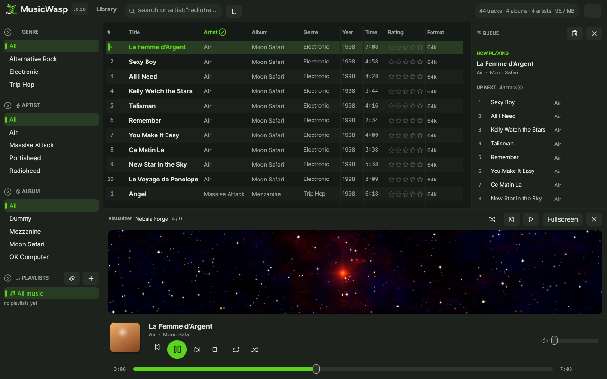

# MusicWasp

A native music manager and player for **Linux, Windows and macOS**. One binary, no Electron and no
web view.

Website: <https://giwisoft.github.io/music-wasp/>  
Full documentation: <https://github.com/GiwiSoft/music-wasp/wiki>


## Features

- Incremental background scanning of 18 audio formats into SQLite
- Genre, artist and album browser with advanced field search and saved searches
- Star ratings, play and skip counts, listening history filters and history sorting
- Persistent track columns, compact rows and album-art rows
- Native playback with gapless preloading, crossfade, ReplayGain, EQ and output selection
- Properties editing with per-track ReplayGain, batch actions and undo
- MusicBrainz auto-tagging with a reviewable file-to-track mapping
- AcoustID fingerprint identification (pure-Rust Chromaprint, build-time key)
- Album grid with cover fetch, replacement and `cover.jpg` sidecars
- Manual and smart playlists, nested folders and M3U import/export
- Library hygiene with missing-file detection and rename reconciliation
- Timestamped library database backups and safe restore
- Tag-based file organizer with preview, collision detection and undo
- English, French, German and Spanish UI
- Fifteen built-in skins, custom JSON skins, background images, a live colour editor and high-contrast mode
- Disc folders, saved searches, session restore and ListenBrainz scrobbling
- Compact always-on-top mini player and optional Linux tray controls
- Linux MPRIS2 desktop controls and native Wayland drag-and-drop
- Podcast subscriptions with RSS feeds, episode progress, and internet radio streams
- Synchronized `.lrc` lyrics with auto-scroll, click-to-seek and embedded tag fallback
- MilkDrop visualizer on wgpu: bundled presets, shuffle, library panel, Now Playing background and fullscreen

## Install

Linux needs ALSA development headers:

```bash
# Debian / Ubuntu
sudo apt install libasound2-dev pkg-config
# Fedora
sudo dnf install alsa-lib-devel
# Arch
sudo pacman -S alsa-lib
```

Windows needs the MSVC Rust toolchain. SQLite is bundled.

macOS releases are unsigned tarballs for Apple Silicon (`macos-arm64`) and Intel
(`macos-x86_64`). Extract the archive and run `./musicwasp`. The first launch may be blocked by
Gatekeeper; use Finder's **Open** context menu, or allow it in
**System Settings → Privacy & Security**.

```bash
cargo build --release
./target/release/musicwasp
```

Or download a release from <https://github.com/GiwiSoft/music-wasp/releases>.

Optional Linux desktop launcher:

```bash
./scripts/install-desktop.sh
```

## Quick start

1. Open **Settings → General**, choose a music folder and press **Scan**.
2. Browse with the left columns or type in **Search**. Try
   `artist:"radiohead" year:1997`.
3. Double-click a track to play. `Space` pauses, `Ctrl+Right` skips.
4. Use the main menu (`☰`) for the queue, lyrics, columns, album grid, equalizer, hygiene tools
   and library filters.
5. Save selections as playlists or build smart playlists from rules.
6. Use **Organize files from tags** to preview and apply folder/file renames, with undo.

## Visualizer

The app renders MilkDrop presets with `wgpu` and feeds them the post-EQ audio stream.

- enable it from **Settings → Visualizer** or the main menu
- 26 bundled presets (lactea originals and Ryan Geiss classics), or drop extra `.milk` / `.milk2`
  files into `<data directory>/presets`
- choose one preset or shuffle every 10-180 seconds, at 30 or 60 fps
- shown above the transport bar, behind the Now Playing screen, and fullscreen with `F11`
- `Esc` leaves fullscreen



## Podcasts and radio

The left sidebar and the main menu have **Podcasts** and **Radio** views.

- **Radio**: add a station name, direct stream URL and optional genre, then press play.
  MP3, OGG and AAC streams supported by the built-in decoder play without external helpers.
- **Podcasts**: add an RSS/Atom feed URL, press Refresh, then play episodes. Episode
  listening position and played state are stored in the library database.
- **Playback controls**, volume, tray and mini-player metadata follow the active stream.
- Live radio has no seek bar; podcast progress is saved but HTTP streams restart from the
  beginning when replayed.
- Feed and station lists are stored alongside the music library in SQLite.
- Podcast feeds and episodes may only reach public addresses. For a podcast server on
  your own network, enable **Allow podcasts from local network addresses** in
  Settings → Track options. Radio URLs you type are not restricted.

Direct audio stream URLs are required. HLS/`.m3u8` playlists, YouTube links and feed pages are
not audio streams and will not play.

## Lyrics

The **Lyrics** panel follows the current local track.

- Put an `.lrc` file beside the audio file with the same base name, for example
  `Song.flac` and `Song.lrc`. Uppercase `.LRC` files are found too.
- `[mm:ss.xx]`, `[mm:ss.xxx]` and `[mm:ss:xx]` timestamps are parsed, together with `[ti:]`,
  `[ar:]`, `[al:]` and `[offset:]` metadata. Multiple timestamps per line and enhanced word
  timestamps are supported.
- UTF-8 and UTF-16 files are read. If no sidecar exists, lyrics stored in the file tag are used.
  Plain unsynchronized text is displayed without highlighting.
- Toggle the panel with the quotes button in the transport bar, the main menu, or the Now Playing
  screen. Synchronized lines highlight and auto-scroll; click a line to seek. The reload button
  rereads the file after edits.
- Lyrics lookup is local only. No online lyric services are queried.

## AcoustID identification

Auto-tag can identify an album from one track's audio fingerprint instead of its tags:

1. Select the album's tracks and open **Auto-tag**.
2. Press **Identify with AcoustID**.
3. Pick the release AcoustID returns and apply as usual.

Fingerprinting is built in: MusicWasp decodes the file with its own decoder and runs the pure-Rust
Chromaprint port. No `fpcalc`, FFmpeg or other external program is needed on Linux, Windows or
macOS.

Release builds embed the free AcoustID application key from the GitHub `production` environment
secret `ACCOUSTID_APIKEY`. Local builds read it from an uncommitted `.env` file at the repository
root (see `.env.example`). Fingerprints are sent to AcoustID only when **Identify with AcoustID**
is pressed.

## CLI

```bash
musicwasp-cli scan ~/Music
musicwasp-cli list --filter 'artist:radiohead year:1997'
musicwasp-cli playlist import ~/Music/mix.m3u8
musicwasp-cli stats
```

## Documentation

The wiki contains the full manual:

| Page | Contents |
| :-- | :-- |
| [Installation](https://github.com/GiwiSoft/music-wasp/wiki/Installation) | builds, releases, desktop launcher |
| [Getting Started](https://github.com/GiwiSoft/music-wasp/wiki/Getting-Started) | first scan, browsing, playback |
| [Library and Search](https://github.com/GiwiSoft/music-wasp/wiki/Library-and-Search) | search syntax, saved searches, ratings, filters, hygiene |
| [Playlists](https://github.com/GiwiSoft/music-wasp/wiki/Playlists) | folders, smart playlists, M3U |
| [File Organizer](https://github.com/GiwiSoft/music-wasp/wiki/File-Organizer) | patterns, preview, collisions, undo |
| [Tagging](https://github.com/GiwiSoft/music-wasp/wiki/Tagging) | editor, batch actions, auto-tag and undo |
| [Playback](https://github.com/GiwiSoft/music-wasp/wiki/Playback-and-Audio) | queue, EQ, ReplayGain, scrobbling, MPRIS |
| [Mini Player and Tray](https://github.com/GiwiSoft/music-wasp/wiki/Mini-Player-and-Tray) | always-on-top player, Linux tray |
| [Appearance](https://github.com/GiwiSoft/music-wasp/wiki/Appearance) | skins, languages, accessibility, layouts |
| [CLI](https://github.com/GiwiSoft/music-wasp/wiki/CLI) | commands and scripting |
| [Configuration](https://github.com/GiwiSoft/music-wasp/wiki/Configuration) | data directory, settings, database |
| [Architecture](https://github.com/GiwiSoft/music-wasp/wiki/Architecture) | modules, workers, Wayland, tests |
| [Development](https://github.com/GiwiSoft/music-wasp/wiki/Development) | tests, watch mode, screenshots, release |
| [Troubleshooting](https://github.com/GiwiSoft/music-wasp/wiki/Troubleshooting) | audio, Wayland, files, reset |
| [Roadmap](https://github.com/GiwiSoft/music-wasp/wiki/Roadmap) | planned work |

## Development

Temporary Wayland patches are tracked in [`patches/REMOVAL.md`](patches/REMOVAL.md); the
`temporary_patches` test fails when the pinned dependencies drift.

```bash
cargo test --workspace
cargo test -p musicwasp-gui --test snapshots
scripts/dev-watch.sh                   # restart GUI on save
WATCH_MODE=check scripts/dev-watch.sh  # fast check
```

## License

GPL-3.0-only. See [LICENSE](LICENSE).

The UI bundles the [Inter](https://rsms.me/inter/) typeface under the SIL Open Font License;
see [`assets/fonts/OFL.txt`](assets/fonts/OFL.txt).

The bundled MilkDrop presets come from [lactea](https://github.com/M0Rf30/lactea) (MIT OR
Apache-2.0) and the original Ryan Geiss preset pack collected by
[projectM](https://github.com/projectM-visualizer/presets-milkdrop-original); see
[`assets/presets/README.md`](assets/presets/README.md) for attribution.

AcoustID fingerprinting runs the MIT-licensed
[rusty-chromaprint](https://github.com/darksv/rusty-chromaprint) port in-process.
