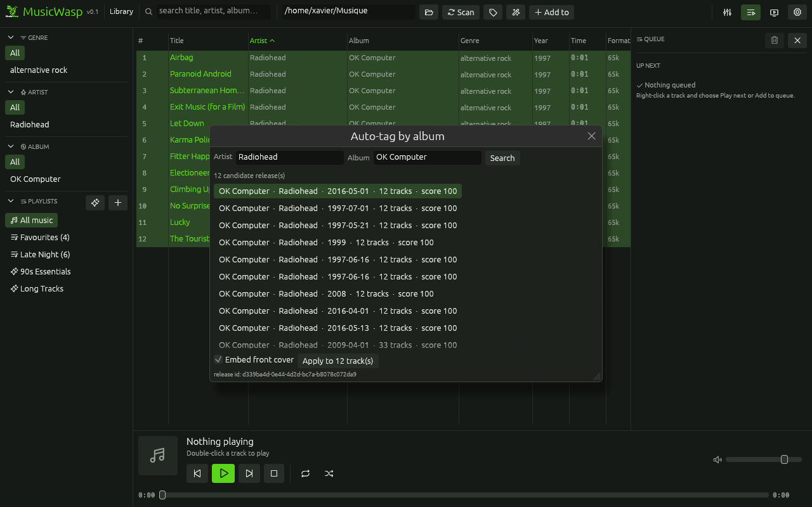
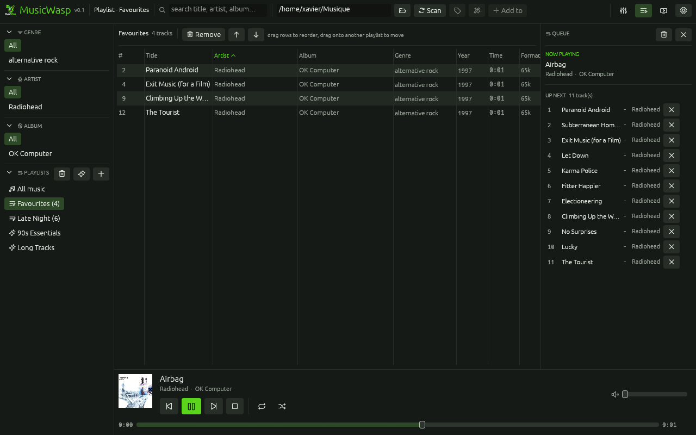
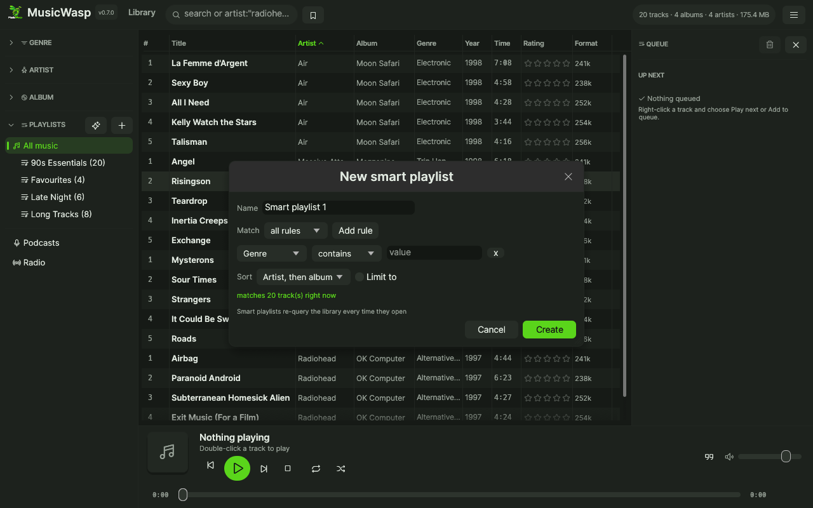
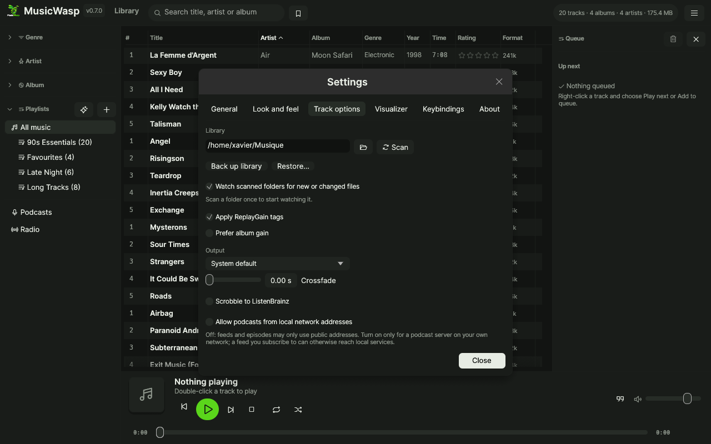
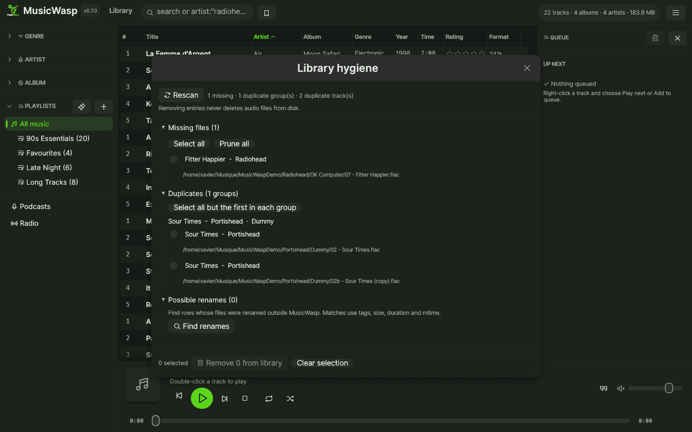
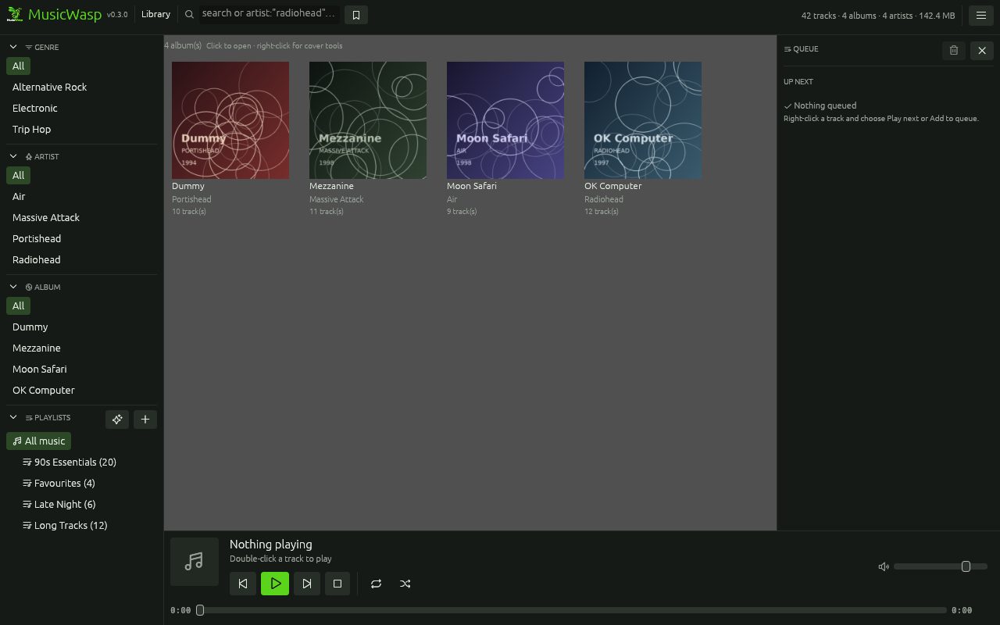
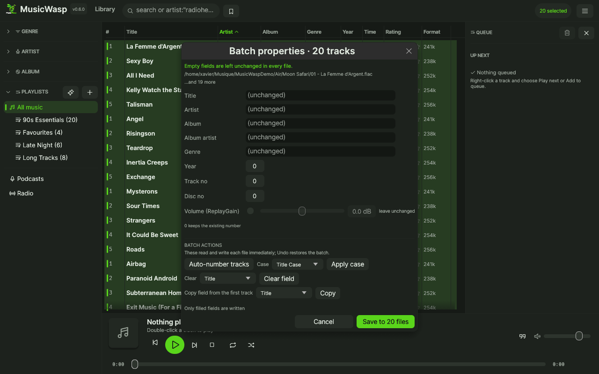
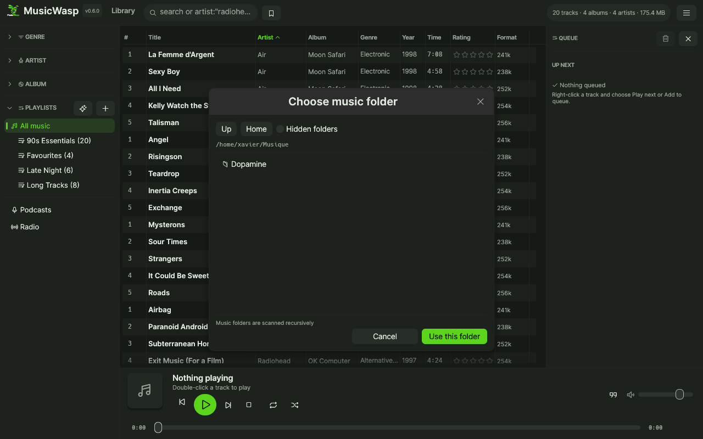

# MusicWasp

A native music manager and player for **Linux and Windows**.

Website: <https://giwi.github.io/music-wasp/>

Point it at your music folders, index the tags, browse by genre / artist / album, play, fix bad
metadata, and keep playlists. No Electron, no web view, one native binary.


## Status

This is an early but working project, not a finished product. What runs today:

| Area | Implemented |
| :-- | :-- |
| Library | recursive scan of 18 audio formats, tag reading via `lofty`, SQLite index |
| Browsing | column browser (genre → artist → album) with foldable sections whose state is remembered, search, sortable table |
| Selection | multi-select (`Ctrl`-click, `Shift`-click, `Ctrl+A`, `Esc`), drag tracks onto a playlist, right-click a row for play / rename / metadata / playlist actions |
| Playback | play / pause / stop / next / prev / seek / volume, repeat (off / all / one), shuffle, gapless preloading and 1–12 s crossfade |
| Output | system default or any enumerated output device, switchable without restarting the app |
| ReplayGain | applies `REPLAYGAIN_TRACK_GAIN` / `REPLAYGAIN_ALBUM_GAIN` per source; choose album gain in Settings |
| Play queue | right-hand Up Next panel: current track, click any entry to jump, drag to reorder, right-click to remove, or clear everything after the current track; **Play next** / **Add to queue** from the track menu |
| Now playing | album art from embedded cover or folder sidecar, accent-highlighted current row, live position |
| Cover tools | album grid view with artwork, fetch missing covers from the Cover Art Archive, replace a cover from an image file, and save it as a `cover.jpg` sidecar |
| Tag editing | edit title, artist, album, album artist, genre, year, track no, disc no and write them into the file; batch edit writes only the fields you fill in |
| Tag batch actions | auto-number selected tracks per disc, normalize text case, clear one field, or copy a field from the first selected track; every action is undoable |
| Plain view | one-click full-window now-playing view: large cover, transport, seek, volume and the next track |
| Renaming | `F2` renames the clicked track field (title, artist, album, genre, year, track no) or the open playlist / smart playlist |
| Folder selection | in-app folder chooser (up/home, hidden folders, recursive scan) plus a path field |
| Auto-tagging | search MusicBrainz by artist + album; preview a file-to-release-track table with per-row overrides and tag diffs; match by disc/track/title/duration, write title/artist/album/album artist/year/genre/track/disc and embed the front cover; every write keeps a pre-write snapshot for Undo |
| File drops | drop audio files or folders from the OS file manager onto a playlist, **All music**, or an open playlist’s track list to import and add them |
| Playlists | save the current view or selection as a playlist, reorder by drag or Up/Down, remove tracks, drag rows onto another playlist to move them |
| Smart playlists | rule-based (field / operator / value, match all or any, sort, limit), re-evaluated from the database every time they open |
| Equalizer | 10-band peaking EQ + preamp, live curve, 8 presets, bypass; applies without restarting the track |
| Skins | five palettes (MusicWasp Dark, Midnight, Forest, Mono, MusicWasp Light), picked from a dropdown in Settings; light mode also swaps the logo |
| Settings | tabbed panel: General (skins, folder watching), Keybindings, About; shortcuts persist to `settings.json` |
| Library hygiene | find rows whose files vanished, detect duplicate artist/title/album groups, and remove entries from the library in bulk; audio files are never deleted |
| Folder watching | scanned folders are watched with `notify`: new audio is imported automatically and external tag edits refresh existing rows; manual **Scan** still works |
| Linux desktop | MPRIS2 service: desktop media keys, GNOME/KDE controls, lock screen, `playerctl` and Bluetooth headset buttons; publishes track, position, volume, shuffle and repeat |
| Scrobbling | optional ListenBrainz now-playing and completed-listen submissions; one toggle plus a user token, no developer API key |
| Session restore | reopens the last view, search, selection, volume, play queue and window size/position; playback always starts stopped |
| Portability | `MUSICWASP_DATA_DIR` for a portable library, data lives in the OS app-data dir by default |

Not there yet (see [Roadmap](#roadmap)): device sync, podcasts/radio, AcoustID fingerprinting.

## Build

Needs a stable Rust toolchain (`rustup`), version 1.85 or newer.

```bash
# Linux (Debian/Ubuntu)
sudo apt install libasound2-dev pkg-config
# Fedora
sudo dnf install alsa-lib-devel
# Arch
sudo pacman -S alsa-lib

cargo build --release
```

If you cannot install packages (no root, locked-down machine), run this once:

```bash
./scripts/dev-env.sh
```

It downloads the distro's ALSA dev package into `.sysroot/` without root.
`.cargo/config.toml` and `core/build.rs` then pick that directory up automatically, so plain
`cargo build` / `cargo run` work afterwards. On a normal machine, or on Windows, both are inert.

On **Windows** nothing extra is required beyond the MSVC toolchain that rustup installs
(SQLite is compiled in through `rusqlite`'s bundled feature, audio goes through WASAPI).

Run it:

```bash
cargo run --release -p musicwasp-gui     # GUI
cargo run --release -p musicwasp-cli -- stats
```

Release binaries land in `target/release/` as `musicwasp` (GUI) and `musicwasp-cli` (CLI).

### Desktop launcher (Linux)

To add MusicWasp to the desktop application menu with its own icon, build the
release binary and install a launcher entry:

```bash
cargo build --release
./scripts/install-desktop.sh
```

The entry lives in `packaging/musicwasp.desktop` and is installed to
`~/.local/share/applications/`, with `assets/ic_launcher-web.png` copied into the
hicolor icon theme. Pass a binary path to override which executable it runs.
The window itself keeps the MusicWasp logo as its window icon; only the launcher
entry uses the app icon.

Tagged Linux archives already contain the binaries, `packaging/musicwasp.desktop`,
`assets/ic_launcher-web.png` and `scripts/install-desktop.sh`; extract the archive and run
`./scripts/install-desktop.sh` (it finds the adjacent `musicwasp` binary). Windows builds embed
`assets/musicwasp.ico` into `musicwasp.exe`, so Explorer, shortcuts and the taskbar show the app
icon before the app starts.

## Usage

1. Start the GUI, pick a folder with the folder button (or type a path), press **Scan**.
2. Browse with the left columns (click an entry again to clear it). Click a section caret to fold it;
   the folded state is saved like the rest of the settings. Type in **Search** to filter.
3. Double-click a track, or select it and press `Enter`, to play. `Space` toggles pause. The
   **QUEUE** panel on the right shows the current track and **Up Next**: click an entry to jump to
   it, drag rows to reorder, right-click a row to remove it, or **Clear** everything after the
   current track. Toggle the panel from the queue icon in the toolbar.
4. Select tracks with `Ctrl`-click / `Shift`-click / `Ctrl+A`. Drag a selection onto a playlist in
   the sidebar to add it there, or right-click a track and use **Add to playlist**.
5. Right-click any track for **Play now**, **Play next**, **Add to queue**, **Rename**, **Edit tags**,
   **Find metadata**, **Remove from playlist** and **Add to playlist**. You can also drop audio files from your file manager onto a playlist,
   **All music**, or anywhere in an open playlist's track list to import and add them.
6. Select a whole album and press **Auto-tag**: search MusicBrainz and pick the right pressing.
   Before anything is written, review the **file-to-release-track** table: each row shows the local
   file, the suggested release track and the tag changes. Override any row with the track dropdown,
   or pick **skip** to leave that file untouched. Matching scores disc/track numbers, titles and
   durations before falling back to file order. **Apply to N track(s)** writes only the mapped rows
   and embeds the front cover by default. Before writing, the previous tags and embedded pictures
   are saved; use **Undo last tag write** in the dialog or the counter-clockwise toolbar button to
   restore them. The same undo snapshot is kept for editor and `F2` writes.
7. Select one track and press **Edit tags** (`Ctrl+F2`) to fix metadata; saved straight into the file.
   Select several and the editor becomes a batch editor: shared values are pre-filled, empty
   fields are left untouched in every file. The **Batch actions** section writes immediately:
   auto-number tracks (per disc), normalize case (title/lower/UPPER), clear a chosen field, or copy
   a field from the first selected track. All batch actions are covered by the same Undo snapshot.
8. The plus button next to **PLAYLISTS** saves the current selection (or the whole view) as a
   playlist; the sparkle button creates a smart playlist from rules. Inside a playlist, drag rows to reorder, use
   **Remove**/`Delete` to drop tracks, **Up**/**Down** (or `Alt`+arrows) to nudge a selection, and
   drag rows onto another playlist to move them there.
9. The monitor button in the toolbar switches to a plain now-playing view with large cover,
   transport, seek, volume and the next track. Press it again to return to the library.
10. Click a track cell (title, artist, album, genre, year, track no) and press `F2` to rename that
   field in place. Click a playlist first and `F2` renames the playlist itself.
11. **Settings** (`Ctrl+,`) has three tabs: **General** for skins and folder watching,
    **Keybindings** for shortcuts, and **About** with the project link and copyright. In
    **Keybindings**, click a binding and press the new combination; `Delete` clears it, `Escape`
    cancels, and conflicts are shown in red.
12. **EQ** (`Ctrl+E`) opens the 10-band equalizer. Pick a preset or move the sliders; the curve and
   the running track update immediately. Changes are saved to `settings.json` automatically.
13. Pick a **Skin** from the dropdown in **Settings**: MusicWasp Dark (default), Midnight, Forest,
    Mono, or MusicWasp Light. The choice, logo and window icon update instantly and are remembered.
    The General tab also toggles ReplayGain (with album-gain preference), picks the output device
    and sets the crossfade length (0 s keeps gapless joins).
14. Close and reopen the app: it comes back to the same view, search, selection, volume, queue and
    window size/position. Playback always starts stopped, with no track loaded; press `Space` to
    play the current queue entry from the beginning. Session state is written every few seconds and
    again on exit.
15. The broom button in the toolbar opens **Library hygiene**. It lists rows whose files are gone
    and groups tracks that share artist/title/album. Tick rows (or use **Select all** / **Select all
    but the first in each group**) and confirm **Remove from library**. Only database entries are
    deleted: audio files stay on disk, and playlist entries disappear with the removed rows. Files
    can be re-imported at any time.
16. A successful **Scan** also watches that folder. New audio files are imported automatically and
    tag changes made in another editor refresh their library rows. Toggle watching in **Settings**.
    Renames and deletions are not auto-pruned; **Library hygiene** reports those rows.
17. On Linux, MusicWasp registers `org.mpris.MediaPlayer2.musicwasp` with the session bus. Desktop
    media keys, GNOME/KDE media controls, the lock screen, `playerctl` and Bluetooth headset
    buttons control playback; track, position, volume, shuffle and repeat are published. Try
    `playerctl --player=musicwasp play-pause`.
18. The grid button in the toolbar switches the track table to an **album grid**. Click a tile to
    open that album, or right-click it for **Fetch missing cover** (Cover Art Archive), **Replace
    cover…** (image picker, embedded into every track in the album) and **Save cover.jpg** beside
    the files. Sidecar covers are used automatically when a file has no embedded art.
19. **Scrobbling** uses ListenBrainz: enable it in **Settings → General** and paste a user token
    from your ListenBrainz profile. MusicWasp sends *playing now* when a track starts and a single
    listen after 50% or four minutes. No developer API key or Last.fm app registration is needed.

### Default shortcuts

| Action | Keys |
| :-- | :-- |
| Play / pause | `Space` |
| Play selected track | `Enter` |
| Next / previous track | `Ctrl+Right` / `Ctrl+Left` |
| Forward / backward 5 seconds | `Ctrl+Shift+Right` / `Ctrl+Shift+Left` |
| Stop | `Ctrl+.` |
| Volume up / down | `Ctrl+Up` / `Ctrl+Down` |
| Rename focused field / playlist | `F2` |
| Edit tags | `Ctrl+F2` |
| Focus search box | `Ctrl+F` |
| Open settings | `Ctrl+,` |
| Open equalizer | `Ctrl+E` |

Bindings live in `settings.json` beside the library database (`~/.local/share/musicwasp/` on
Linux, `%APPDATA%\musicwasp\` on Windows), and are written atomically on every change. Delete
the file, or press **Reset to defaults**, to start over.



Editing a playlist (reorder, remove, drag between playlists):



Smart playlists are rules, evaluated live:





Finding missing files and duplicate rows without touching the audio:



Album grid with cover tools:



Batch editing several tracks at once:



Choosing the folder to scan:



Roughly 5k tracks index in a couple of seconds; the table stays responsive while playing because
audio runs on its own thread and the UI reads lock-free snapshots.

CLI, handy for scripting and for checking the library without a display:

```bash
musicwasp-cli scan ~/Music          # index a folder
musicwasp-cli scan ~/Music --rescan # re-read tags even for unchanged files
musicwasp-cli list --filter "floyd"
musicwasp-cli play 42               # play library track 42
musicwasp-cli stats

# auto-tag by album: search, then apply the best match to tracks 1-12
musicwasp-cli autotag -r "Radiohead" -l "OK Computer"
musicwasp-cli autotag -r "Radiohead" -l "OK Computer" \
    --apply best --ids 1,2,3,4,5,6,7,8,9,10,11,12 --cover
```

Auto-tagging talks to `musicbrainz.org` and `coverartarchive.org`: no API key, but it needs
network access and respects MusicBrainz's one-request-per-second limit (with retry/backoff on
429/503). AcoustID is **not** wired up: it needs a registered API key *and* a local
`fpcalc`/chromaprint install to fingerprint files, so this path uses release lookup instead —
which is what "tag by album" needs in practice.

## Architecture

```
core/   musicwasp-core   library DB (SQLite), tags, playback/DSP, auto-tag, playlists
gui/    musicwasp        egui/eframe UI, skins, settings, playlists
cli/    musicwasp-cli    headless library tool
```

- **`core::library`** owns the connection. `Track`/`Filter`/`SortKey` are the only types the UI
  needs, so SQL stays in one place.
- **`core::player`** spawns an audio thread that owns the `cpal` output stream and a `rodio` sink.
  The UI sends commands over an `mpsc` channel and reads an `Arc<Shared>` of atomics, so a slow
  or missing audio device can never freeze the interface. Decoded samples pass through
  **`core::dsp::DspSource`** before reaching the sink; the shared [`EqShared`] handle lets the UI
  change the equalizer while a track is playing.
- **`core::dsp`** is a 10-band RBJ peaking EQ with a preamp. Filters are biquads, one chain per
  channel, and settings arrive as a snapshot with a version counter so the audio callback does not
  take a mutex for every sample. Bypass is a straight pass-through; output is clamped to avoid wrap
  clipping at extreme settings.
- **`core::tags`** writes through `lofty`, then the row is re-read so the UI never shows stale data.
- **`core::playlist`** is a plain join table; playlist order is explicit, and move/remove keep
  positions dense so reordering is a single ordered rewrite.
- **`core::smart`** stores a JSON rule set and compiles it to one parameterised SELECT, with the
  field/operator names coming from enums rather than user text.
- **`core::autotag`** is split into pure steps (`search`, `fetch`, `suggest`, `apply`) so matching
  and tag writing are unit-tested without network; only `search`/`fetch`/`front_cover` do I/O, from
  a worker thread so the UI never blocks.
- **`gui::settings`** maps actions to a normalised token (`ctrl+right`, `space`), stores them as
  JSON, and reports conflicts; the app dispatches keys from that table instead of hardcoding them.
  It also persists the equalizer state and the selected skin.
- **`gui::theme`** is a small skin engine: named palettes drive egui's `Visuals` and the colours
  that custom-painted widgets (equalizer curve, drag marker, album-art placeholder) use directly.

Database schema (SQLite, `PRAGMA journal_mode=WAL`):

```
tracks(id, path UNIQUE, title, artist, album, album_artist, genre, year,
       track_no, disc_no, duration_secs, sample_rate, bitrate, channels,
       format, size_bytes, mtime, added_at)
playlists(id, name)
playlist_tracks(playlist_id, track_id, position)
```

## Testing

```bash
cargo test --workspace          # tags, filters, playlists, smart rules, shortcuts, auto-tag, EQ, skins
```

The tests synthesise their own WAV files, so they need no sample library and no audio device.

Dev-only screenshot hooks (used to produce the images above):

```bash
MUSICWASP_SCREENSHOT=/tmp/shot.png MUSICWASP_AUTOPLAY=1 cargo run -p musicwasp-gui
MUSICWASP_SCREENSHOT=/tmp/plain.png MUSICWASP_AUTOPLAY=1 MUSICWASP_PLAIN=1 cargo run -p musicwasp-gui
MUSICWASP_SCREENSHOT=/tmp/tags.png MUSICWASP_EDITOR=1 cargo run -p musicwasp-gui
MUSICWASP_SCREENSHOT=/tmp/rename.png MUSICWASP_RENAME=1 cargo run -p musicwasp-gui
MUSICWASP_SCREENSHOT=/tmp/eq.png MUSICWASP_EQ=1 cargo run -p musicwasp-gui
MUSICWASP_SCREENSHOT=/tmp/settings.png MUSICWASP_SETTINGS=1 MUSICWASP_SETTINGS_TAB=about cargo run -p musicwasp-gui
MUSICWASP_SCREENSHOT=/tmp/hygiene.png MUSICWASP_HYGIENE=1 cargo run -p musicwasp-gui
MUSICWASP_SCREENSHOT=/tmp/grid.png MUSICWASP_ALBUM_GRID=1 cargo run -p musicwasp-gui
MUSICWASP_SCREENSHOT=/tmp/undo.png MUSICWASP_UNDO=1 cargo run -p musicwasp-gui
```

`MUSICWASP_DATA_DIR=/some/dir` isolates a test library from your real one.

On Wayland, winit has no native file drag-and-drop. MusicWasp therefore starts on X11
(XWayland) when `DISPLAY` is available, which makes dropping files from the file manager work.
Set `MUSICWASP_NATIVE_WAYLAND=1` to keep the native Wayland backend (drop will not work there).

## Roadmap

Planned improvements:

1. **AcoustID fingerprinting** on top of the existing auto-tag (needs a key + `fpcalc`).
2. **Editing existing smart playlists** (currently create/delete only) plus rating and play-count
   fields to build rules on.
3. **Device sync** (MTP / Android) and podcast + internet radio support.

## License

GPL-3.0-only. See [LICENSE](LICENSE).
