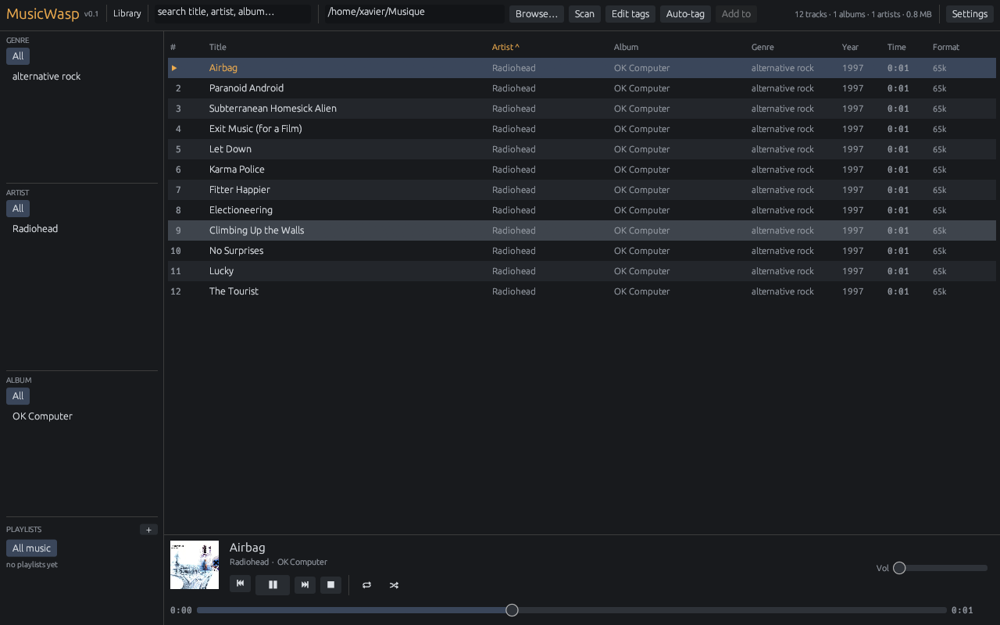

# MusicWasp

A native music manager and player for **Linux and Windows**. One binary, no Electron and no web
view.

Website: <https://giwisoft.github.io/music-wasp/>  
Full documentation: <https://github.com/GiwiSoft/music-wasp/wiki>



## Features

- Incremental background scanning of 18 audio formats into SQLite
- Genre, artist and album browser with advanced field search and saved searches
- Star ratings, play and skip counts, listening history filters and history sorting
- Persistent track columns, compact rows and album-art rows
- Native playback with gapless preloading, crossfade, ReplayGain, EQ and output selection
- Properties editing with per-track ReplayGain, batch actions and undo
- MusicBrainz auto-tagging with a reviewable file-to-track mapping
- Album grid with cover fetch, replacement and `cover.jpg` sidecars
- Manual and smart playlists, nested folders and M3U import/export
- Library hygiene with missing-file detection and rename reconciliation
- Timestamped library database backups and safe restore
- Tag-based file organizer with preview, collision detection and undo
- English, French, German and Spanish UI
- Fifteen built-in skins, custom JSON skins, background images, a live colour editor and high-contrast mode
- Disc folders, saved searches, session restore and ListenBrainz scrobbling
- Compact always-on-top mini player and optional Linux tray controls
- Linux MPRIS2 desktop controls and native Wayland drag-and-drop

## Install

Linux needs ALSA development headers:

```bash
# Debian / Ubuntu
sudo apt install libasound2-dev pkg-config
# Fedora
sudo dnf install alsa-lib-devel
# Arch
sudo pacman -S alsa-lib
```

Windows needs the MSVC Rust toolchain. SQLite is bundled.

```bash
cargo build --release
./target/release/musicwasp
```

Or download a release from <https://github.com/GiwiSoft/music-wasp/releases>.

Optional Linux desktop launcher:

```bash
./scripts/install-desktop.sh
```

## Quick start

1. Open **Settings → General**, choose a music folder and press **Scan**.
2. Browse with the left columns or type in **Search**. Try
   `artist:"radiohead" year:1997`.
3. Double-click a track to play. `Space` pauses, `Ctrl+Right` skips.
4. Use the main menu (`☰`) for the queue, columns, album grid, equalizer, hygiene tools and
   library filters.
5. Save selections as playlists or build smart playlists from rules.
6. Use **Organize files from tags** to preview and apply folder/file renames, with undo.

## CLI

```bash
musicwasp-cli scan ~/Music
musicwasp-cli list --filter 'artist:radiohead year:1997'
musicwasp-cli playlist import ~/Music/mix.m3u8
musicwasp-cli stats
```

## Documentation

The wiki contains the full manual:

| Page | Contents |
| :-- | :-- |
| [Installation](https://github.com/GiwiSoft/music-wasp/wiki/Installation) | builds, releases, desktop launcher |
| [Getting Started](https://github.com/GiwiSoft/music-wasp/wiki/Getting-Started) | first scan, browsing, playback |
| [Library and Search](https://github.com/GiwiSoft/music-wasp/wiki/Library-and-Search) | search syntax, saved searches, ratings, filters, hygiene |
| [Playlists](https://github.com/GiwiSoft/music-wasp/wiki/Playlists) | folders, smart playlists, M3U |
| [File Organizer](https://github.com/GiwiSoft/music-wasp/wiki/File-Organizer) | patterns, preview, collisions, undo |
| [Tagging](https://github.com/GiwiSoft/music-wasp/wiki/Tagging) | editor, batch actions, auto-tag and undo |
| [Playback](https://github.com/GiwiSoft/music-wasp/wiki/Playback-and-Audio) | queue, EQ, ReplayGain, scrobbling, MPRIS |
| [Mini Player and Tray](https://github.com/GiwiSoft/music-wasp/wiki/Mini-Player-and-Tray) | always-on-top player, Linux tray |
| [Appearance](https://github.com/GiwiSoft/music-wasp/wiki/Appearance) | skins, languages, accessibility, layouts |
| [CLI](https://github.com/GiwiSoft/music-wasp/wiki/CLI) | commands and scripting |
| [Configuration](https://github.com/GiwiSoft/music-wasp/wiki/Configuration) | data directory, settings, database |
| [Architecture](https://github.com/GiwiSoft/music-wasp/wiki/Architecture) | modules, workers, Wayland, tests |
| [Development](https://github.com/GiwiSoft/music-wasp/wiki/Development) | tests, watch mode, screenshots, release |
| [Troubleshooting](https://github.com/GiwiSoft/music-wasp/wiki/Troubleshooting) | audio, Wayland, files, reset |
| [Roadmap](https://github.com/GiwiSoft/music-wasp/wiki/Roadmap) | planned work |

## Development

Temporary Wayland patches are tracked in [`patches/REMOVAL.md`](patches/REMOVAL.md); the
`temporary_patches` test fails when the pinned dependencies drift.

```bash
cargo test --workspace
cargo test -p musicwasp-gui --test snapshots
scripts/dev-watch.sh                   # restart GUI on save
WATCH_MODE=check scripts/dev-watch.sh  # fast check
```

## License

GPL-3.0-only. See [LICENSE](LICENSE).

The UI bundles the [Inter](https://rsms.me/inter/) typeface under the SIL Open Font License;
see [`assets/fonts/OFL.txt`](assets/fonts/OFL.txt).
